<p align="center">
  
</p>

<p align="center">
  <samp>C# · .NET 8 · WPF · MVVM</samp>
</p>

### <samp>01 — WHAT IT IS</samp>

An image editor written for an image-processing course at Óbuda University. Every
operation is implemented by hand on raw pixel data, with no imaging library doing the
work, and the app reports how each one changed the picture.

The filters and the measurements live in two separate libraries behind an MVVM WPF front
end, so the processing code has no dependency on the UI.

### <samp>02 — OPERATIONS</samp>

| Group | Operations |
|---|---|
| Point operations | Negation, gamma correction, logarithmic transform, grayscale conversion |
| Histogram | Histogram rendering, histogram equalisation |
| Smoothing | Box filter, Gaussian filter |
| Edges and features | Sobel, Laplace, Harris corner detection |

After a filter runs, the analytics library measures the result: basic image statistics,
the share of pixels that are edges, and the number of Harris keypoints.

### <samp>03 — PROJECTS</samp>

| Project | Role |
|---|---|
| `ImageProcessing.Core` | The filters (`ImageProcessor`) |
| `ImageProcessing.Analytics` | Statistics, edge percentage, keypoint counting (`ImageAnalyzer`) |
| `Photoshop` (`ImageProcessing.WpfApp`) | WPF front end: `MainViewModel`, `RelayCommand`, result window |

### <samp>04 — RUN IT</samp>

Requires Windows and the .NET 8 SDK.

```bash
dotnet run --project Photoshop/Photoshop/ImageProcessing.WpfApp.csproj
```

Or open `Photoshop/Photoshop.sln` in Visual Studio 2022.

### <samp>05 — WRITE-UPS</samp>

Both are in Hungarian.

- `Photoshop/Irodalomkutatas.docx`: literature review
- `Photoshop/Projektben_hasznalt_algoritmusok_es_optimalizaciok.docx`: the algorithms used
  and how they were optimised

<br />

<p align="center">
  <sub><samp>MORE WORK AT <a href="https://github.com/Deatron01">GITHUB.COM/DEATRON01</a></samp></sub>
</p>
